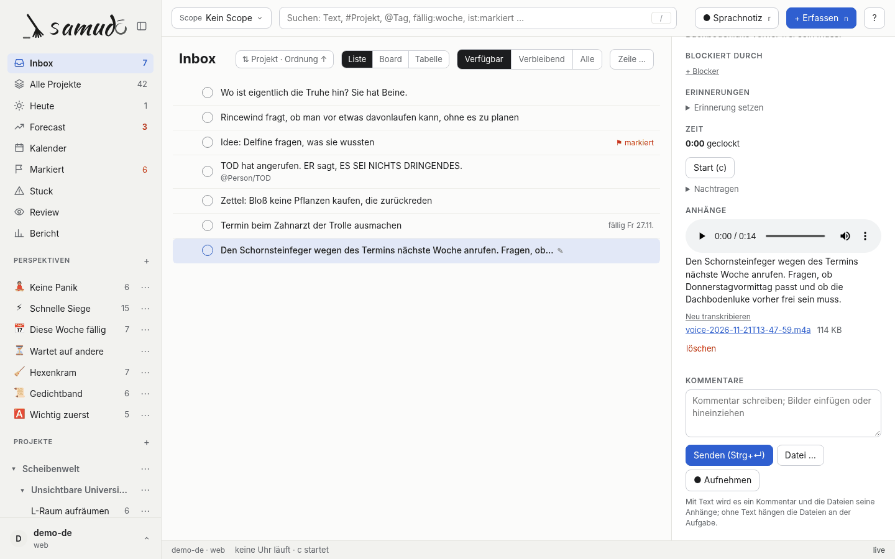

# Web-Oberfläche

Der Server liefert die Web-Oberfläche unter `/` aus. Sie braucht sonst
nichts: keinen Build-Schritt, nichts von fremden Seiten. Anmelden mit
Konto und Passwort; die Sitzung ist ein Cookie. Die Oberfläche spricht
Deutsch oder Englisch, gewählt je Browser (siehe [Sprache](#sprache)).

Nimmt der Server [Registrierungen](self-hosting.md#registrierung) an,
hat die Anmeldeseite dazu „Konto anlegen“: Name, Passwort und die Sprache
des Demo-Inhalts („keine“, wo der Server es erlaubt). Auf einem
Demo-Server legt „Ausprobieren“ ein Demo-Konto an, ohne etwas zu fragen,
und zeigt Name und Passwort einmal; ein Banner sagt danach, an welchem Tag
das Konto gelöscht wird, wenn es bis dahin nicht benutzt wird.

## Aufbau

Drei Spalten: links die Seitenleiste, in der Mitte die Liste, rechts die
Details der gewählten Aufgabe. Unter 800 px Breite stapeln sie sich, und
die Aufgabe ersetzt die Liste („‹ Liste“ geht zurück).

### Obere Leiste

- **Suche** (`/`): freier Text und Chips, siehe [Suchsprache](search.md).
- **Sprachnotiz** („● Sprachnotiz“, `r`): nimmt Ton auf; nochmal drücken
  legt eine Inbox-Aufgabe „Sprachnotiz *Datum Uhrzeit*“ mit der Aufnahme
  als Anhang an; Escape verwirft. Auf einem Server mit
  [Transkript-Dienst](self-hosting.md#transkripte) wird das Gesprochene
  danach zum Titel (die erste Zeile) und zur Notiz, wenn du beides
  inzwischen nicht geändert hast.
- **Erfassen** („+ Erfassen“, `n`): das Fenster der
  [Schnellerfassung](quick-capture.md). Beim Tippen erscheint die Vorschau
  des Servers als Chips und Warnungen; in `#…` und `@…` schlägt es bekannte
  Projekte und Tags vor (↑ ↓, Tab oder Enter nimmt einen). Enter legt die
  Aufgabe an; Tab legt sie an und öffnet sie in den Details. `C` und eine
  Taste erfasst mit einer Vorlage. Fügt man
  [mehrere Zeilen](quick-capture.md#mehrere-zeilen) ein, drückt
  Umschalt+Enter oder den Schalter „Mehrere Zeilen“, wird das Fenster
  mehrzeilig und zeigt jede Aufgabe in der Vorschau; Enter legt alle an,
  Umschalt+Enter beginnt eine neue Zeile. „mehrere Zeilen erfassen“ kann
  eine eigene Taste bekommen.
- **Scope**-Auswahl: der [Scope](concepts.md#scopes) dieses Browsers. Ein
  Scope mit Farbe tönt die Linie zwischen Seitenleiste und Liste, solange
  er gewählt ist.

### Seitenleiste

Das Kontomenü, die Ansichten (Inbox, Alle Projekte, Heute, Forecast,
Kalender, Markiert, Stuck, Review, Bericht), die eigenen Perspektiven,
dann Ordner und Projekte mit der Zahl verfügbarer Aufgaben.

Das **Kontomenü** nennt, wer angemeldet ist; eine
[beschränkte Sitzung](cli.md#agenten) zeigt dazu ihre Freigabe
(„Freigabe: tec/ai · lesen und schreiben“). Es hat „Konto“ (seine
Einstellungen), die Darstellung (System, Hell, Dunkel), die
[Sprache](#sprache) (System, Deutsch, English), „Handy koppeln“ und
„Abmelden“. Die Sitzung einer Person über das ganze Konto hat dazu
„Sitzungen“: jede Sitzung des Kontos mit Gerät, Art, Freigabe und den
Tagen, an denen sie begann und abläuft; „Beenden“ beendet eine. Die
eigene endet mit „Abmelden“.

`[` schaltet die Seitenleiste durch voll, schmal (Symbole, und Kacheln mit
zwei Initialen oder dem Emoji eines Ordners oder Projekts) und weg; die
Wahl bleibt im Browser. Ordner und Projekte lassen sich hier anlegen,
umbenennen, verschieben und zuklappen, und Aufgaben lassen sich auf ein
Projekt oder die Inbox ziehen.

Ansichten und Perspektiven oben lassen sich **anordnen**
([ADR 0142](../adr/0142-arranging-the-sidebar.md)). Das Menü einer
Perspektive hat „Zu den Ansichten“, das sie zwischen die Ansichten
stellt, und „Zurück zu den Perspektiven“; dort lassen sich die Einträge
in jede Reihenfolge ziehen. Jeder Eintrag außer Inbox hat „In der
Leiste ausblenden“. Einstellungen → Leiste zeigt alle mit Griff und
Schalter, dazu „Alle wieder zeigen“. Eine ausgeblendete Ansicht öffnet
weiter über ihre Taste und die Palette, eine ausgeblendete Perspektive
wirkt weiter als Block einer Block-Perspektive. Ein angepasstes „Heute“
ist so eine Block-Perspektive an der Stelle von „Heute“, mit „Heute“
ausgeblendet. Die Anordnung gilt nur in diesem Browser.

„+“ bei Perspektiven legt eine Perspektive oder eine
[Block-Perspektive](concepts.md#perspektiven) an; „Blöcke …“ im Menü
einer Block-Perspektive listet ihre Blöcke: Perspektiven, die Ansichten
Inbox, Heute und Markiert oder eine eigene Suche hinzufügen, einem eine
eigene Überschrift geben, per Ziehen oder ↑ ↓ ordnen, entfernen, und
„Doppelte nur einmal“ schalten. Eine eigene Suche wird in ihrer Zeile
bearbeitet: die Suche, der Filter, Gruppieren, Sortieren und Liste oder
Tabelle. „Lösen“ macht aus einem Block, der auf eine Perspektive
verweist, eine Kopie ihrer Suche; „Als Perspektive sichern …“ macht aus
einer Suche eine Perspektive, auf die der Block dann verweist. „Als
Text“ zeigt die Blöcke als Zeilen, eine je Block, wie unter
[Perspektiven](concepts.md#perspektiven) beschrieben, mit einer Vorschau,
was aus jeder Zeile wird und wie viele Aufgaben sie zeigt; eine Zeile,
die kein Block ist, wird markiert, und der Dialog sichert erst, wenn sie
stimmt.

In der Liste ist jeder Block ein Abschnitt zum Zuklappen; seine
Überschrift öffnet die Perspektive oder Ansicht des Blocks, und seine
Zeilen sind angeordnet wie in dieser Perspektive, als Liste oder Tabelle
(ein Board erscheint als Liste). Eine eigene Suche ist so angeordnet,
wie sie es sagt, und „⋯“ in ihrer Überschrift sichert sie als
Perspektive. Das Suchfeld sucht dort über alles. Eine Suche in der
Suchleiste kommt mit „Als Block in …“ direkt in eine Block-Perspektive
oder in eine neue.

### Liste

- Ein Schalter für **Verfügbar / Verbleibend / Alle**.
- **Anordnen**: gruppieren nach Projekt, Ordner, Tag, Zustand, Priorität,
  Datum oder gar nicht; sortieren nach eigener Reihenfolge, fällig,
  geplant, Start, Titel, angelegt, geändert, Schätzung oder Priorität, mit
  einem zweiten Schlüssel; bleibt je Ansicht in diesem Browser.
- Jede Zeile zeigt die Priorität als Balken, den Titel, ein Zeichen für
  eine Notiz, die Markierung und 🚧 für einen Blocker. **Zeile …**
  bestimmt den Rest, in diesem Browser für alle Listen. Es zeigt Zeile 1
  mit dem Titel, Zeile 2 und „Aus“ als Reihen von Feldern (Fällig,
  Zustand, Tags, Ort, Grund, Start, Geplant, Schätzung, Wiederholung,
  die erste Zeile der Notiz, erstellt, geändert): ein Feld an seine
  Stelle ziehen, oder mit ← → in seiner Reihe und ↑ ↓ in die Reihe
  darüber oder darunter verschieben. Ein Feld vor dem Titel steht vor
  ihm, eins dahinter neben ihm, eins in Zeile 2 darunter. Ab Werk steht
  der Zustand vor dem Titel, Fällig dahinter, Tags, Ort und Grund
  darunter. Beide Zeilen bleiben einzeilig; was hinten steht, fällt
  zuerst weg, Felder vor dem Titel nie. „Kurzform mit Symbolen“
  schreibt `▶ Mo 10.11.` für Start, `◷` für Geplant, `~1h30` für die
  Schätzung, `↻2w` für eine Wiederholung und Tags als Chips.
- **Board** („Liste | Board“): dieselben Aufgaben als Karten in Spalten.
  Die Spalten sind die Zustände eines Ablaufs oder eine geordnete Liste von
  Tags, dazu „Ohne“ und „Erledigt“ (die letzten 7 Tage), jede mit einem
  optionalen WIP-Limit. Eine Karte ziehen setzt den Zustand, tauscht den
  Tag, erledigt oder öffnet wieder. `z` zeigt das Board im Vollbild.
- **Tabelle** („Liste | Board | Tabelle“): dieselben Zeilen wie die Liste,
  je Feld eine Spalte. „Spalten“ wählt sie: Zustand, Priorität, Projekt,
  Tags, Start, Fällig, Geplant, Erstellt, Geändert, Erledigt, Schätzung,
  Ist, Rest (Schätzung − Ist), Blocker und jede Property; ein Kopf lässt
  sich ziehen, um die Spalte zu verschieben. Eine Aktionsgruppe zeigt
  Schätzung, Ist und Rest ihres ganzen Teilbaums, ein Gruppenkopf die
  Summen seiner Zeilen, die letzte Zeile die Summe über alles; Ist zählt
  jede Uhr, eine laufende bis jetzt, also dieselbe Zahl wie der Bericht.
  Ein Klick auf einen Kopf sortiert danach, ein zweiter umgekehrt
  (Properties, Ist und Tags sortieren noch nicht). Eine Perspektive merkt
  sich ihre Spalten auf dem Server, sonst merkt sie sich dieser Browser.
- **Bearbeiten in der Tabelle:** ein Klick auf eine Zelle bearbeitet sie
  dort: Zustand und Priorität als Knöpfe (ihre Kürzel wählen sofort),
  Daten, Schätzung und eine Property als Feld (Enter oder Verlassen
  schreibt, leer nimmt den Wert weg), Tags als Chips mit ✕ und ein Feld,
  das einen Tag per Name hinzufügt (⌫ im leeren Feld nimmt den letzten).
  Ist, Erstellt, Geändert, Projekt, Erledigt und Blocker werden nur
  gezeigt. Mit der Tastatur wählen ← → eine Zelle der gewählten Zeile,
  Enter öffnet sie, Esc schließt ohne zu schreiben.

### Details

Für die gewählte Aufgabe: Ort, Titel, ID (mit Knopf zum Kopieren),
Priorität, Verfügbarkeit mit jedem Grund, Zustand, erledigen / verwerfen /
wieder öffnen, Markierung, Projekt, Daten, Wiederholung, Erinnerungen,
Tags, Notiz (als Org oder Markdown gerendert; Stift oder Doppelklick
bearbeitet sie, Checkboxen sind klickbar, `samu:`-Links öffnen die
Aufgabe), Properties, Links, Blocker, Anhänge, Kommentare, Zeit, Serie
einer Gewohnheit, Logbuch. Das Layout eines Scopes kann Teile davon
wegklappen.

`]` (oder ⤢, oder ein Doppelklick auf ihre Zeile) zeigt die Aufgabe über
die mittlere und rechte Spalte, den Text in lesbarer Breite.

**Checkliste:** unter der Notiz, überschrieben „Checkliste“ mit
`erledigt/alle`, sobald es Punkte gibt. Jeder Punkt ist eine Zeile mit
Checkbox und Feld; Enter in einem Feld macht darunter den nächsten Punkt,
Rücktaste in einem leeren löscht ihn und springt zurück, Alt+↑ / Alt+↓ oder
Ziehen am Griff verschiebt ihn, und mehrere eingefügte Zeilen zerfallen in
Punkte (siehe [Konzepte](concepts.md#checklisten)). „↳“ macht aus einem
Punkt eine Unteraufgabe, ✕ löscht ihn. Das Feld „Punkt hinzufügen …“ am
Ende behält den Cursor für den nächsten. „↳ Alle in Unteraufgaben“ macht
die ganze Liste zu Unteraufgaben, „↴ Alle Unteraufgaben in Punkte“ tut das
Umgekehrte für die schlichten Unteraufgaben; eine, die kein Punkt werden
kann, bleibt und wird genannt. Am Inspektor einer Unteraufgabe tut
„In Checkpunkt umwandeln“ das für sie allein. Eine Zeile in der Liste
zeigt `☑ 2/5`. Das Layout eines Scopes kann die Checkliste wegfalten.

Kommentare werden wie die Notiz gerendert und zeigen ihren Autor, mit
„Agent“ markiert, wenn ein Agent sie geschrieben hat. Was eine Sitzung
deiner Art geschrieben hat, kannst du bearbeiten und löschen. Darunter
nimmt ein Feld Text und Dateien: einfügen, hineinziehen, auswählen oder
mit „● Aufnehmen“ Ton aufnehmen.

Unter dem Player einer Aufnahme steht ihr Transkript, sobald es eines
gibt. Hat der Server einen Transkript-Dienst, bittet „Transkribieren“
darum und „Neu transkribieren“ um ein neues; solange der Server daran
arbeitet, steht das da, und ein Fehlschlag zeigt seinen Grund mit
„Erneut versuchen“.

### Viele auswählen

Strg- oder ⌘-Klick nimmt eine Zeile dazu, Umschalt-Klick einen Bereich,
Leertaste die aktuelle Zeile. Eine Leiste bietet dann erledigen, wieder
öffnen, verwerfen, markieren, verschieben, Tag an/aus, Zustand, Datum
(fällig/geplant/Start: heute, morgen, ein Tag, leeren), „Bearbeiten …“
und löschen. Die Auswahl lässt sich auf ein Projekt oder die Inbox in der
Seitenleiste ziehen.

Eine Aufgabe mit offenen Aufgaben darunter zu erledigen oder zu verwerfen
fragt zuerst, auf welchem Weg auch immer (der Kreis, der Inspektor, das
Menü, `x`, die Board-Spalte „Erledigt“, die Leiste): „Mit erledigen“
(Enter), „Herausholen“ oder „Abbrechen“, siehe
[Konzepte](concepts.md#erledigen-mit-offenen-aufgaben-darunter). Eine
Auswahl bekommt eine Frage für alle („2 der 5 Aufgaben haben offene
Unteraufgaben“); offene Aufgaben, die selbst gewählt sind, zählen nicht.

„Bearbeiten …“ (oder `e`) öffnet einen Dialog für alle gewählten
Aufgaben: ohne Titel, mit den Chips, die alle gemeinsam haben (✕ oder
Rücktaste nimmt einen von jeder; beim Projekt heißt das: in die Inbox),
und einer Zeile in der Syntax der [Schnellerfassung](quick-capture.md),
die jeder etwas hinzufügt, etwa `@besorgung d:fr`.

### Statuszeile

Konto und Gerät, die laufende Uhr mit Aufgabe und Zeit (Klick hält sie
an), und ob die Live-Aktualisierung (`/events`) verbunden ist.

## Ansichten

| Ansicht | |
|---|---|
| Forecast | überfällig, heute, markiert, die nächsten Tage und später, mit Terminen; die Einstellungen bestimmen, wie viele Tage und was erscheint |
| Kalender | siehe [unten](#kalender) |
| Stuck | aktive Projekte ohne verfügbare Aufgabe |
| Review | Projekte, deren Review fällig ist; `R` markiert das Projekt als geprüft |
| Bericht | drei Reiter, „Erledigt“, „Bearbeitet“ und „Zeit“, über eine Spanne (heute, gestern, diese oder letzte Woche, dieser Monat, 30 Tage, frei), gruppiert nach Aufgabe, Projekt, Ordner, Tag oder Datum, mit einem Filter in der Suchsprache |

### Kalender

Tag, Woche, Monat oder Liste, umgeschaltet im Kopf und gemerkt im
Browser; ‹ Heute › blättert.

- **Tag** und **Woche**: ein Raster ab 7 Uhr mit einer Linie für jetzt
  und einem Band für Ganztägiges. Termine in der Farbe ihres Kalenders
  (vorläufige schraffiert); Aufgaben mit geplanter Uhrzeit gestrichelt, so
  lang wie ihre geplante Dauer, sonst ihre Schätzung, sonst 30 Minuten.
- **Monat**: sechs Wochen, Montag bis Sonntag. Jeder Tag zeigt seine
  Termine (ganztägige zuerst) und darunter die für ihn geplanten
  Aufgaben; was nicht hineinpasst, steht als „+N“ da. Ein Klick aufs
  Datum öffnet den Tag, auf einen Eintrag öffnet ihn, auf eine freie
  Stelle legt einen ganztägigen Termin an. Ein Termin über mehrere Tage
  steht an jedem von ihnen.
- **Liste**: ab heute, nur die Tage, an denen etwas ist, mit denselben
  Einträgen wie im Monat; zuerst 30 Tage, „Mehr“ lädt die nächsten 30.
  Zum Lesen und Springen; bearbeitet wird über das Blatt.

Das Blatt eines Termins nennt seine Erinnerungen („10 Min. vorher“, „am
Vortag um 09:00“ bei einem ganztägigen). Das Formular eines neuen oder
geänderten Termins hat denselben Wiederholungs-Editor wie Aufgaben
(täglich, wöchentlich an Wochentagen, monatlich am Tag oder am n-ten
Wochentag, jährlich, ein Intervall und ein Ende: nie, an einem Datum oder
nach N Mal). Eine Regel, die der Editor nicht darstellen kann, bleibt als
Text stehen und unverändert, bis man sie ersetzt.

## Einstellungen

„Einstellungen“ (`g s`) hat diese Abschnitte:

- **Scopes**; **„Projekte und Ordner“** (Symbole, „Nur im Scope“);
  **Tags** (Status; Ablauf und Standard-Ablauf; Taste und Notiz eines
  Zustands, siehe [Abläufe](concepts.md#abläufe-und-zustände)); **Forecast** (mit der Uhrzeit,
  zu der sich Erinnerungen an Daten ohne Uhrzeit melden).
- **„Kalender“**: Quellen, Farben, der Standardkalender für neue Termine.
  Der Editor eines CalDAV-Kalenders bietet „Weitere Kalender von *Host*“:
  die übrigen Kalender auf diesem Server, gefunden und hinzugefügt mit
  Nutzer und Passwort, die dieser schon hat (sie verlassen den Server
  nie), jeder mit einer Farbe; schon vorhandene sind ausgegraut. Ein
  schreibbarer CalDAV-Kalender hat „ICS-Datei importieren …“: Jeder
  Termin der Datei geht unverändert an den Server des Kalenders (samt
  Erinnerungen und Teilnehmern), einer mit derselben UID ersetzt den
  vorhandenen, und das Ergebnis nennt, wie viele angelegt, ersetzt,
  übersprungen und gescheitert sind. Kalender abrufen braucht einen
  [geheimen Schlüssel](self-hosting.md#der-geheime-schlüssel) auf dem
  Server.
- **„Erinnerungen“**: „Erinnerungen an Termine“ und „Erinnerungen an
  Aufgaben“, anfangs beide aus und nur in diesem Browser gemerkt.
  Eingeschaltet fragt die Seite einmal nach der Erlaubnis für
  Benachrichtigungen und zeigt eine Browser-Meldung, wenn eine Erinnerung
  fällig ist; ein Klick öffnet Aufgabe oder Termin. Was bis zu zehn
  Minuten vor dem Öffnen der Seite fällig war, kommt einmal nach, und ein
  zweiter Tab meldet es nicht noch einmal. Ist kein Tab der
  Web-Oberfläche offen, kommt nichts.
- **Properties** (Link-Vorlagen je Schlüssel); **„Vorlagen“** (Vorlagen
  und ihre Tasten); **„Tastatur“** (Tastenbelegung).
- **„Konto“**: „Demodaten holen“ holt den Demo-Inhalt ins Konto (in ein
  leeres alles, sonst unter einen Ordner und einen Tag „Demo“), und ein
  registriertes Konto löscht sich dort mit seinem Passwort („Konto
  löschen“).

## Sprache

Die Seite ist englisch, bis man wählt. Das Kontomenü, und die
Anmeldeseite unter ihren Formularen, wählt die Sprache dieses Browsers:
„System“ (Deutsch, wenn der Browser Deutsch bevorzugt, sonst Englisch),
„Deutsch“ oder „English“. Die Wahl wird nicht gesynct; die Seite lädt in ihr neu, und
Daten folgen ihr. Die [Suchsprache](search.md) versteht beide Sprachen,
gleich was gewählt ist. Die Tasten bleiben in beiden dieselben. Namen,
die man selbst vergibt (Projekte, Tags, Zustände eines Ablaufs), werden
nicht übersetzt, und Fehlermeldungen des Servers bleiben englisch.

## Tasten

`?` zeigt die Belegung. Die Vorgaben:

| Taste | |
|---|---|
| `j` `k`, ↓ ↑ | nächste / vorige Aufgabe |
| Enter | öffnen |
| Leertaste | Aufgabe auswählen |
| `x` | erledigen / wieder öffnen |
| `s` | nächster Zustand (reihum) |
| `t` + Taste | einen Zustand über seine Taste wählen |
| `f` | markieren |
| `c` | Uhr an der Aufgabe starten / anhalten |
| `e` | mit Zeichen bearbeiten (`@tag #projekt !A d:fr …`) |
| `m` | verschieben (Refile): unscharfe Suche über Inbox, Projekte und Aktionsgruppen; Enter verschiebt, Tab macht sie zum Kind |
| `>` `<` | einrücken / ausrücken |
| Umschalt+↑ Umschalt+↓ | eine Stelle nach oben / unten |
| `N` | neue Unteraufgabe |
| `n` | erfassen |
| `C` + Taste | mit einer Vorlage erfassen |
| `r` | Sprachnotiz |
| `/` | suchen |
| `R` | Projekt als geprüft markieren |
| Entf | löschen … |
| Umschalt+F10, Rechtsklick | das Menü der Aufgabe |
| Alt+← Alt+→ | im Board: Karte eine Spalte weiter |
| `z` | Board im Vollbild |
| ← → Enter | in der Tabelle: Zelle wählen, bearbeiten (Esc bricht ab) |
| `[` | Seitenleiste: voll, schmal, weg |
| `]` | Aufgabe über die ganze Breite |
| `o` | springen: unscharfe Suche über Ansichten, Perspektiven und die Projekte, Ordner und Tags, die der Scope zeigt (Projekte und Ordner mit Pfad); Enter öffnet |
| `g i`, `g f`, `g m`, `g p`, `g r`, `g z`, `g k`, `g s` | zu Inbox, Forecast, Markiert, Projekte, Review, Bericht, Kalender, Einstellungen |
| Escape | zurück |

Mit einer Auswahl wirken `x`, `f`, `m`, `s`, `t`, `e` und Entf auf alle
gewählten Aufgaben. Jede Belegung lässt sich unter „Tastatur“ ändern
(gespeichert im Konto, also bekommt sie jeder Browser; auf der
Kommandozeile `samu settings set keys`).

## Adressen

Die Adresszeile zeigt immer, was die Seite zeigt; so lässt sich jeder
Stand als Lesezeichen ablegen oder als Link verschicken:

- die Ansicht ist der Pfad: `/` (Inbox), `/v/projects`, `/v/today`,
  `/v/forecast`, `/v/calendar`, `/v/flagged`, `/v/stuck`, `/v/review`,
  `/v/report`; ein Projekt oder eine Perspektive ist `/o/<id>`;
- die Query ergänzt `q=` (die Suche, wie man sie tippt), `scope=<id>`
  (oder `scope=none`), `show=remaining` oder `show=all`, im Kalender
  `mode=day|week|month|list` und `day=2026-12-01`, und `open=<id>` für die
  offene Aufgabe, mit `full=1`, wenn sie das Fenster füllt.

`/?q=@home&show=all` listet alle Aufgaben mit dem Tag `home`, erledigte
eingeschlossen. Ein Projekt, Tag oder Ordner in `q` wird beim
Öffnen der Seite über seinen Namen gesucht. Ein Wechsel der Ansicht ist
ein Schritt in der Geschichte des Browsers; „Zurück“ führt zur vorigen.

## Links von außen

`/o/<id>` öffnet ein Objekt. Auf einem Rechner mit installierter
Kommandozeile öffnen auch `samu:`-Links aus anderen Programmen hier (siehe
[Kommandozeile](cli.md#links-öffnen)).

## Live

Die Seite folgt `/events`, solange der Tab sichtbar ist: Was sich auf
einem anderen Gerät ändert, erscheint ohne Neuladen.
