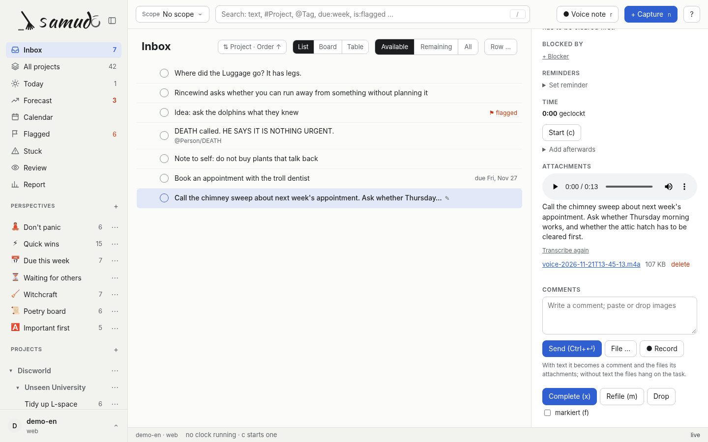

# Web UI

The server serves the web UI at `/`. It needs nothing else: no build step,
nothing loaded from other sites. Sign in with account and password; the
session is a cookie. The interface speaks German or English, chosen per
browser (see [Language](#language)); this page uses the English labels.

When the server takes [registrations](self-hosting.md#registration), the
sign-in page also has "Create account": a name, a password and the language
of the demo content ("none", where the server allows it). On a
demo server "Try it" makes a demo account without asking anything
and shows its name and password once; a banner then says on which day the
account is deleted unless it is used before.

## Layout

Three columns: the sidebar on the left, the list in the middle, the
inspector of the selected task on the right. Below 800 px width they stack,
and the task replaces the list ("‹ List" goes back).

### Top bar

- **Search** (`/`): free text and chips, see [Search language](search.md).
- **Voice note** ("● Voice note", `r`): records audio; pressing again
  files an inbox task "Voice note *date time*" with the recording
  attached; Escape discards. On a server with a
  [transcript service](self-hosting.md#transcripts) what you said then
  becomes the title (its first line) and the note, unless you have
  changed them in the meantime.
- **Capture** ("+ Capture", `n`): the [quick capture](quick-capture.md)
  window. While you type, the server's preview shows as chips and warnings;
  inside `#…` and `@…` it suggests known projects and tags (↑ ↓, Tab or
  Enter takes one). Enter creates the task; Tab creates it and opens it in
  the inspector. `C` and a key captures with a template. Pasting
  [several lines](quick-capture.md#several-lines), Shift+Enter or the switch
  "Several lines" turns the window into a field of several lines with a
  preview of each task; Enter creates them all, Shift+Enter starts a new
  line. "capture several lines" can get a key of its own.
- **Scope** picker: the [scope](concepts.md#scopes) of this browser. A
  scope with a colour tints the line between sidebar and list while it is
  chosen.

### Sidebar

The account menu, the views (Inbox, All projects, Today, Forecast,
Calendar, Flagged, Stuck, Review, Report), your perspectives, then
folders and projects with the number of available tasks.

The **account menu** names who is signed in; a
[restricted session](cli.md#agents) also shows its grant ("Grant: tec/ai
· read and write"). It has "Account" (its settings), the theme (System,
Light, Dark), the [language](#language) (System, Deutsch, English), "Pair
a phone" and "Sign out". A person's session of the whole account also has
"Sessions": every session of the account with device, kind, grant, and
the days it began and runs out; "End" ends one. The current one ends with
"Sign out".

`[` cycles the sidebar through full, narrow (icons, and tiles with two
initials or the emoji of a folder or project) and hidden; the choice is
kept in the browser. Folders and projects can be created, renamed, moved
and folded here, and tasks can be dragged onto a project or the inbox.

The views and perspectives at the top can be **arranged**
([ADR 0142](adr/0142-arranging-the-sidebar.md)). A perspective's menu
has "Move to the views", which puts it among the views, and "Back to
the perspectives"; entries there can be dragged into any order. Every
entry but Inbox has "Hide in the sidebar". Settings → Sidebar lists them
all with a handle and a switch, and "Show all again". A hidden view
still opens by its key and from the palette, and a hidden perspective
still works as a block of a block perspective. So a customised Today is
a block perspective moved to the place of Today, with Today hidden. The
arrangement is kept in this browser only.

"+" at Perspectives makes a perspective or a
[block perspective](concepts.md#perspectives); "Blocks …" in a block
perspective's menu lists its blocks: add perspectives, the views Inbox,
Today and Flagged, or a search of its own; give one a heading of its
own, order them by dragging or ↑ ↓, remove them, and switch "Duplicates
once". A search of its own is edited in its row: the search, the filter,
grouping, sorting, and list or table. "Detach" turns a block that points
at a perspective into a copy of its search; "Save as perspective …"
turns a search into a perspective the block then points at. "As text"
shows the blocks as lines, one per block, as described under
[perspectives](concepts.md#perspectives), with a preview of what each
line becomes and how many tasks it shows; a line that is no block is
marked, and the dialog saves only once it is fixed.

In the list each block is a section that folds; an empty one is dimmed
and folded each time the perspective is opened. Its heading opens the
block's perspective or view, and its rows are arranged as that
perspective arranges them, as a list or a table (a board shows as a
list). A block's own search is arranged as it says, and "⋯" in its
heading saves it as a perspective. The search field there searches
everything. A search in the search bar can go straight into a block
perspective with "As a block in …", or into a new one.

### List

- A switch for **Available / Remaining / All**.
- **Arrange**: group by project, folder, tag, state,
  priority, date or nothing; sort by own order, due, planned, defer,
  title, created, modified, estimate or priority, with a second key; kept
  per view in this browser.
- Each row shows the priority as a bar, the title, a note mark, a flag
  and 🚧 for a blocker. **Row …** decides the rest, in this browser for
  every list. It shows line 1 with the title, line 2 and "Off" as rows
  of fields (due, state, tags, place, reason, defer, planned, estimate,
  repeat, the note's first line, created, modified): drag a field to
  its place, or move it with ← → within its row and ↑ ↓ to the row
  above or below. A field before the title stands in front of it, one
  after it beside it, one in line 2 below it. By default the state
  stands before the title, the due date after it, and tags, place and
  reason below. Both lines stay one line; what stands last is cut
  first, fields before the title never. "Short form with symbols"
  writes `▶ Mon 10 Nov` for defer, `◷` for planned, `~1h30` for the
  estimate, `↻2w` for a repetition and tags as chips.
- **Board** ("List | Board"): the same tasks as cards in columns. The
  columns are the states of a workflow or an ordered list of tags, plus
  "None" and "Completed" (the last 7 days), each with an optional
  work-in-progress limit. Dragging a card sets the state, swaps the tag,
  completes or reopens. `z` shows the board full screen.
- **Table** ("List | Board | Table"): the same rows as the list, one
  column per field. "Columns" chooses them: state, priority, project,
  tags, defer, due, planned, created, modified, completed, estimate,
  worked, remaining (estimate − worked), blockers, and any property; drag
  a head to move its column. An action group shows estimate, worked and
  remaining of its whole subtree, a group's head the sums of its rows,
  the last row the sum of all; worked counts every clock, a running one
  up to now, the same number as the report. A click on a head sorts by
  it, a second click reverses (properties, worked and tags do not sort
  yet). A perspective keeps its columns on the server; elsewhere they are
  kept in this browser.
- **Editing in the table:** a click on a cell edits it there: state and
  priority as buttons (their keys pick at once), dates, the estimate and a
  property as a field (Enter or leaving it writes, empty takes the value
  away), tags as chips with ✕ and a field that adds one by name (⌫ in the
  empty field takes the last off). Worked, created, modified, project,
  completed and blockers are only shown. With the keyboard ← → choose a
  cell of the selected row, Enter opens it, Escape closes it without
  writing.

### Inspector

For the selected task: place, title, id (with a copy button), priority,
availability with every reason, state, complete / drop / reopen, flag,
project, dates, repetition, reminders, tags, note (rendered as Org or
Markdown; a pencil or double click edits it, checkboxes are clickable,
`samu:` links open the task), properties, links, blockers, attachments,
comments, time, habit streak, logbook. A scope's layout can fold parts of
it away.

Start, due and planned each have a day and, beside it, a time of day.
An empty time is a whole day. Changing the day keeps the time, changing
the time keeps the day, and the time is read in the account's zone.

`]` (or ⤢, or a double click on its row) shows the task across the middle
and right columns, the text in readable width.

**Checklist:** below the note, titled "Checklist" with `done/all`
once there are items. Each item is a line with a check box and a field;
Enter in a field makes the next item below it, Backspace in an empty one
deletes it and goes back, Alt+↑ / Alt+↓ or dragging the grip moves it,
and pasting several lines splits them into items (see
[Concepts](concepts.md#checklists)). "↳" turns an item into a subtask, ✕
deletes it. The field "Add item …" at the end keeps the cursor for the
next one. "↳ All into subtasks" turns the whole list into subtasks, and
"↴ All subtasks into items" does the reverse for the plain subtasks; a
subtask that cannot become an item stays and is named. On a subtask's own inspector, "Turn into a checklist item" does it for
that one. A row in
the list shows `☑ 2/5`. A scope's layout can fold the checklist away.

Comments are rendered like the note and show their author, marked "Agent"
when an agent wrote them. You can edit and delete what a session of your
kind wrote. Below them a field takes text and files: paste, drop, choose,
or record audio with "● Record".

Under the player of a recording stands its transcript, once there is one.
Where the server has a transcript service, "Transcribe" asks for it and
"Transcribe again" for a new one; while the server is at it the line says
so, and a failure shows its reason with "Try again".

### Selecting many

Ctrl- or ⌘-click adds a row, Shift-click a range, Space the current row. A
bar then offers complete, reopen, drop, flag, move, tag on/off, state, date
(due/planned/defer: today, tomorrow, a day, clear), "Edit …" and delete.
The selection can be dragged onto a project or the inbox in the sidebar.

Completing or dropping a task with open tasks below asks first, whichever
way it goes (the circle, the inspector, the menu, `x`, the board column
"Completed", the bar): "Complete them too" (Enter), "Lift out" or
"Cancel", see [Concepts](concepts.md#completing-a-task-with-open-tasks-below).
A selection gets one question for all ("2 of the 5 tasks have open
subtasks"); open tasks that are selected themselves do not count.

"Edit …" (or `e`) opens one dialog for all selected tasks: no title, the
chips they all share (✕ or Backspace takes one off each; a project
means a move to the inbox) and a line in
[quick capture](quick-capture.md) syntax that adds to each, such as
`@errand d:fri`.

### Status line

Account and device, the running clock with its task and time (click stops
it), and whether live updates (`/events`) are connected.

## Views

| View | |
|---|---|
| Forecast | overdue, today, flagged, the next days and later, with appointments; settings decide how many days and what shows |
| Calendar | see [below](#calendar) |
| Stuck | active projects without an available task |
| Review | projects due for review; `R` marks the project reviewed |
| Report | three tabs, "Completed", "Worked on" and "Time", over a span (today, yesterday, this or last week, this month, 30 days, free), grouped by task, project, folder, tag or day, with a filter in the search language |

### Calendar

Day, Week, Month or List, switched in the head and kept in the browser;
‹ Today › pages.

- **Day** and **Week**: a grid from 7 o'clock with a line for now and a
  band for all-day items. Appointments in their calendar's colour
  (tentative ones hatched); tasks with a planned time dashed, as long as
  their planned duration, else their estimate, else 30 minutes.
- **Month**: six weeks, Monday to Sunday. Each day lists its appointments
  (all-day ones first) and below them the tasks planned for it; what does
  not fit shows as "+N". A click on the date opens the day, on an item
  opens it, on a free spot makes an all-day appointment. An appointment
  over several days stands on each of them.
- **List**: from today, only the days with something on them, the same
  items as in the month; 30 days first, "More" adds the next 30. For
  reading and jumping; editing goes through the sheet.

An appointment's sheet names its reminders ("10 min before", "the day
before at 09:00" for an all-day one). The form of a new or changed
appointment has the same repetition editor as tasks (daily, weekly on
weekdays, monthly on a day or the n-th weekday, yearly, an interval, and
an end: never, on a date or after N times). A rule the editor cannot show
stays as text and unchanged until you replace it.

## Settings

"Settings" (`g s`) has these sections:

- **Scopes**; **"Projects and folders"** (icons, "Only in scope");
  **Tags** (status; workflow and default workflow; a state's key and
  note, see [workflows](concepts.md#workflows-and-states)); **Forecast** (with the hour at
  which reminders on dates without a time go off).
- **"Calendar"**: sources, colours, the default calendar for new
  appointments. The editor of a CalDAV calendar offers "More calendars
  from *host*": the other calendars on that server, found and added with
  the user and password this one already has (they never leave the
  server), each with a colour; those already there are greyed out. A
  writable CalDAV calendar has "Import ICS file …": each event of the
  file goes to the calendar's server as it is (reminders and attendees
  included), one with the same UID replaces the one there, and the result
  says how many were created, replaced, skipped and failed. Fetching
  calendars needs a [secret key](self-hosting.md#the-secret-key) on the
  server.
- **"Reminders"**: "Reminders of appointments" and "Reminders of tasks",
  both off at first and kept in this browser only. Switched on, the page
  asks once for permission to notify and shows a browser notification
  when a reminder goes off; a click opens the task or the appointment.
  What went off up to ten minutes before the page was opened comes once
  more, and a second tab does not repeat it. Nothing comes while no tab
  of the web UI is open.
- **Properties** (link templates per key); **"Templates"** (templates
  and their keys); **"Keyboard"** (key bindings).
- **"Account"**: "Get demo data" fetches the demo content into the
  account (all of it into an empty one, else under a folder and a tag
  "Demo"), and a registered account deletes itself there with its
  password ("Delete account").

## Language

The page is English until you choose. The account menu, and the sign-in
page below its forms, choose the language of this browser: "System"
(German if the browser prefers German, else English), "Deutsch" or
"English". The choice is not synced; the page reloads in it, and dates
follow it. The [search language](search.md) understands both languages
whatever is chosen. Keys stay the same in both. Names you give (projects,
tags, workflow states) are not translated, and error messages from the
server stay English.

## Keys

`?` shows the bindings. The defaults:

| Key | |
|---|---|
| `j` `k`, ↓ ↑ | next / previous task |
| Enter | open |
| Space | select the task |
| `x` | complete / reopen |
| `s` | next state (round) |
| `t` + key | pick a state by its key |
| `f` | flag |
| `c` | start / stop the clock on the task |
| `e` | edit with marks (`@tag #project !A d:fri …`) |
| `m` | move (refile): fuzzy search over inbox, projects and action groups; Enter moves, Tab makes it a child |
| `>` `<` | indent / outdent |
| Shift+↑ Shift+↓ | move one place up / down |
| `N` | new child task |
| `n` | capture |
| `C` + key | capture with a template |
| `r` | voice note |
| `/` | search |
| `R` | mark the project reviewed |
| Delete | delete … |
| Shift+F10, right click | the task's menu |
| Alt+← Alt+→ | on the board: move the card a column |
| `z` | board full screen |
| ← → Enter | in the table: choose a cell, edit it (Escape cancels) |
| `[` | sidebar: full, narrow, hidden |
| `]` | task across the full width |
| `o` | jump: fuzzy search over the views, perspectives, projects, folders and tags the scope shows (projects and folders with their path); Enter opens |
| `g i`, `g f`, `g m`, `g p`, `g r`, `g z`, `g k`, `g s` | go to inbox, forecast, flagged, projects, review, report, calendar, settings |
| Escape | back |

With a selection, `x`, `f`, `m`, `s`, `t`, `e` and Delete act on all
selected tasks. Every binding can be changed under "Keyboard" (stored in the
account, so every browser gets it; `samu settings set keys` on the command
line).

## Addresses

The address bar always shows what the page shows, so every state can be
bookmarked or sent as a link:

- the view is the path: `/` (inbox), `/v/projects`, `/v/today`,
  `/v/forecast`, `/v/calendar`, `/v/flagged`, `/v/stuck`, `/v/review`,
  `/v/report`; a project or a perspective is `/o/<id>`;
- the query adds `q=` (the search, as you would type it), `scope=<id>`
  (or `scope=none`), `show=remaining` or `show=all`, in the calendar
  `mode=day|week|month|list` and `day=2026-12-01`, and `open=<id>` for the
  open task, with `full=1` when it fills the window.

`/?q=@home&show=all` lists every task tagged `home`, done ones included. A project, tag or folder named in `q` is looked up by name when
the page opens. Changing the view is a step in the browser's history,
so Back returns to the previous one.

## Links from outside

`/o/<id>` opens an object. On a computer with the command line installed,
`samu:` links in other programs open here too (see [CLI](cli.md#opening-links)).

## Live

The page follows `/events` while the tab is visible: what changes on
another device appears without reloading.
